# SundarTV

**A beautiful, ad-free home screen for Android TV and Google TV.** Made by JC.

*Sundar* means beautiful. SundarTV replaces your TV's cluttered, ad-filled home screen with a calm one that
follows the sky outside.

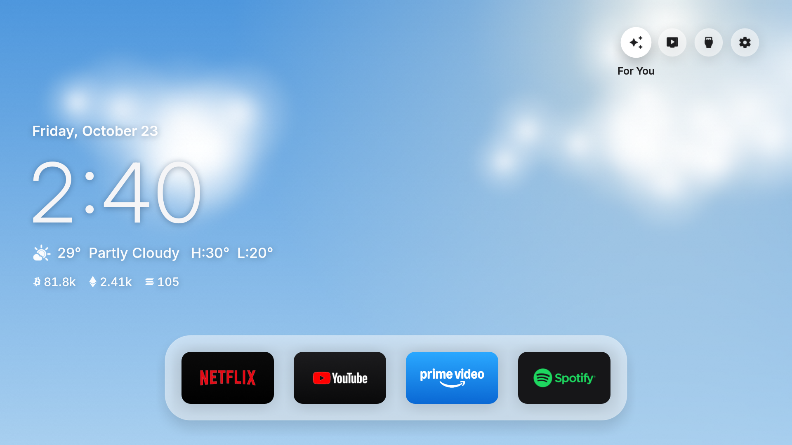

| Rain | Snow |
| --- | --- |
| 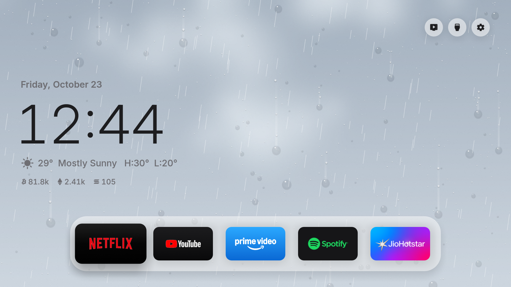 | 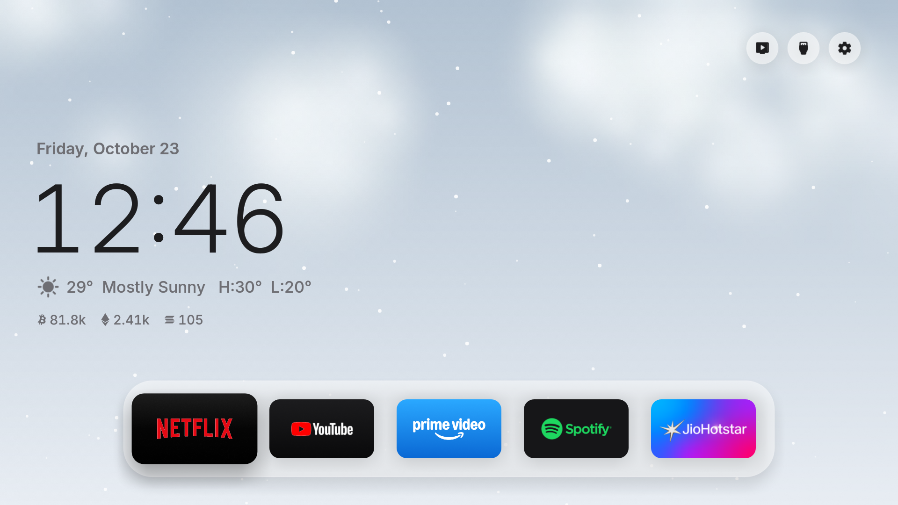 |

| Screensaver | Settings |
| --- | --- |
| 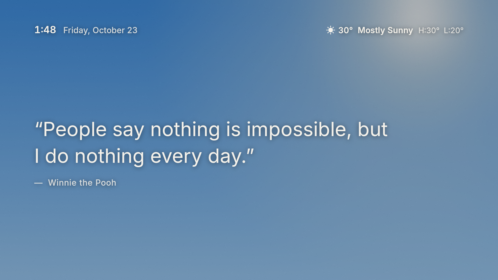 | 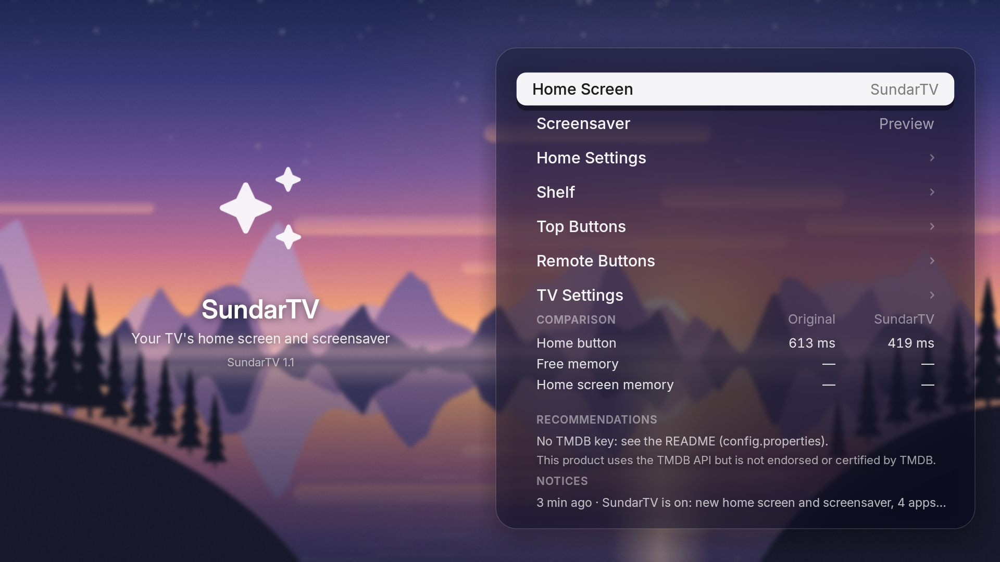 |

## What you get

- **The sky outside, live.** The background follows your city's real weather: clear blue with the sun's glow,
  clouds, fog, a rainy window with drops on frosted glass, falling snow, and thunderstorms with lightning. Rain and
  snow move; day turns to night at your real sunset.
- **No ads.** No sponsored rows, banners or autoplaying promos.
- **Your apps up front.** The streaming apps you use, on a glass shelf you arrange on the TV.
- **A quote screensaver.** A funny quote over the live sky behind dim frosted glass, a new one every two minutes,
  with the time, date and weather at the top.
- **Settings over a frosted mountain lake** at dusk.
- **Frosted glass everywhere:** the shelf, the buttons and the drawer (press down: inputs, shortcuts, the
  forecast and prices) show the sky blurred behind them, even on Android 8.

  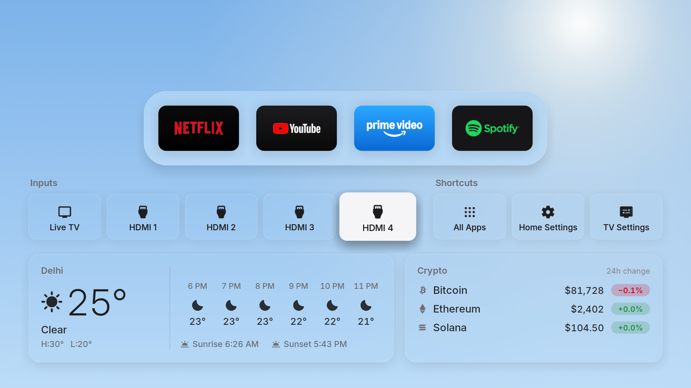
- **The clock and the weather** at a glance, with text colors that match the sky.
- **Wi-Fi and Bluetooth pills** at the top right: your network's name and whether Bluetooth is on. One press opens the
  TV's network page (join or switch networks) or its pairing page (speakers, headphones, remotes).
- **Safe.** No root, nothing uninstalled. One button brings back the TV's original home screen.

## Install (Android TV / Google TV)

You need an Android TV or Google TV (Android 8 or newer) and a computer on the same Wi-Fi.

1. **On the TV:** Settings → System (or Device Preferences) → About → press *Build* 7 times. Then in Developer
   options, turn on **USB debugging**. Note the TV's IP address (Settings → Network & Internet).
2. **On the computer:** a JDK 17+, the Android SDK command-line tools (build-tools 34+, platform android-34) and
   `adb`. On Windows, run the build from Git Bash.
3. **Build:** `./build.sh`. The first run creates `config.properties`: set your city (`latitude`, `longitude`,
   `city`), your country (`tmdb_region`) and, if you like, a free TMDB key for trending picks (see
   [Trending picks](#trending-picks-tmdb)). Run it again.
4. **Install:**
   ```
   adb connect <TV-IP>:5555
   adb install -r SundarTV.apk
   ```
5. **Switch on the TV:** open SundarTV → Home Screen → SundarTV, and accept *Allow USB debugging* (tick *Always
   allow*).

To pick when the screensaver starts: Settings → Device Preferences → Screen saver → When to start.

Keep `sundartv.keystore`: updates must be signed with the same key.

## Trending picks (TMDB)

With a free TMDB key, a **For You** button joins the round buttons at the top right of the home screen. It opens a
recommendations page: movies and shows, only from streaming apps your TV already has, in four tabs (For You, Explore,
Movies, Shows), with fresh picks every hour. **Back** returns to the home screen, which always stays the clock and the
weather over the sky. Each card shows the genre,
runtime (or seasons) and the app it's on.

- **More than three:** keep pressing right past the third card and more titles slide in (up to 12 per tab).
- **The story:** rest on a card for a moment and its synopsis rises over the picture.

| Synopsis on a held card | More titles slide in |
| --- | --- |
| 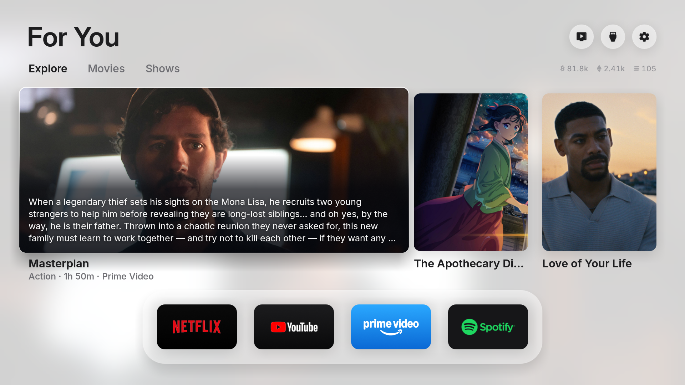 | 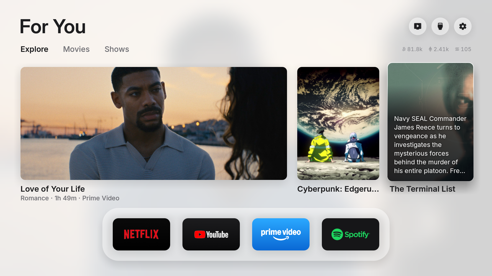 |

### For You

Streaming apps don't share what you watch, so For You uses what the TV itself can know:

- **More like what you open:** the titles you open from SundarTV's cards are remembered (on the TV only) and TMDB's
  recommendations for the last three fill the tab, only from your apps.
- **Your apps first:** the apps you used most in the past two weeks come first (Android's usage stats; SundarTV
  grants itself usage access when you switch it on).
- Before you've opened anything, it shows this hour's picks from your most-used apps.

For You always sits on the live weather sky.

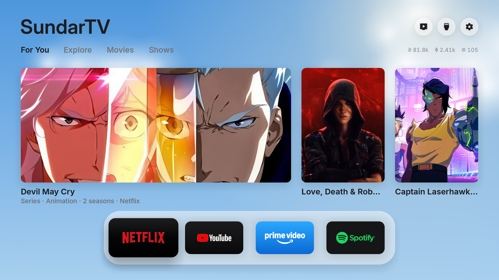

**Get a key** (free, two minutes): create an account at [themoviedb.org](https://www.themoviedb.org), open
Settings → API and request a developer key. Paste the **API Key** (or the API Read Access Token) after `tmdb_key=`
in `config.properties`, then build and install again. `config.properties` is in `.gitignore`: your key never goes to
GitHub.

**Choose the look** in SundarTV → Home Settings:

| Setting | Options |
| --- | --- |
| Background | *Weather sky* (the default) or *Movie art* (the first pick's image), on the recommendations page |
| Screensaver | *Quotes* (the default) or *Movie photos* (a slideshow of the picks) |

| Picks over the weather sky | Home Settings |
| --- | --- |
| 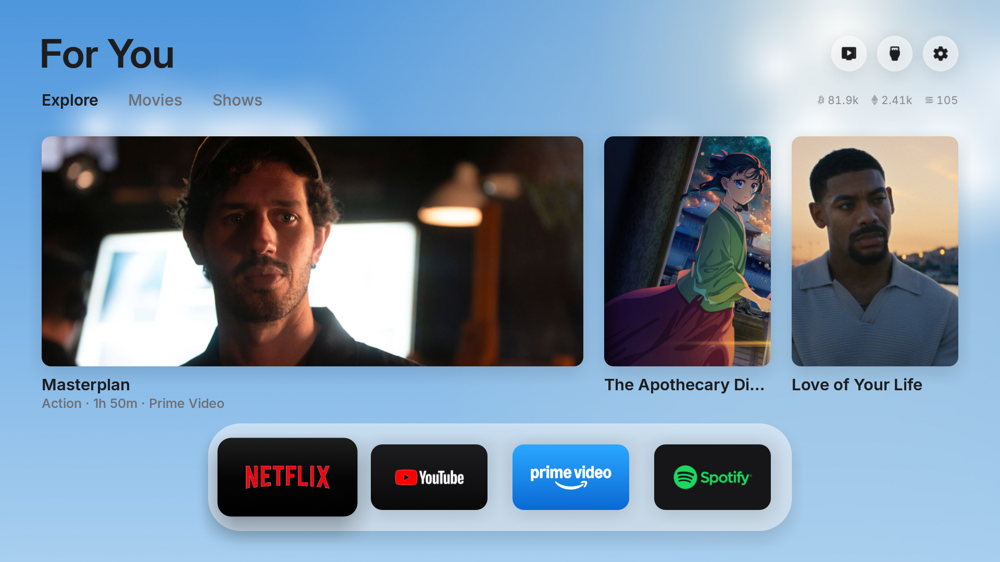 | 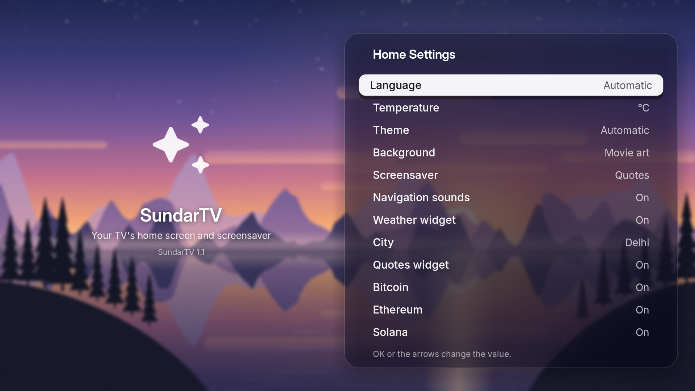 |

Without a key, everything else works: the weather sky, the shelf, the quote screensaver.

## Going back

SundarTV → Home Screen → **Original** brings back the TV's home screen, screensaver and every app it turned off.
If the home screen ever crashes three times in five minutes, it switches back by itself. To remove it, switch to
Original first, then uninstall SundarTV (Settings → Apps).

## LG and Samsung

The same home screen also builds as an app for LG (webOS 3+) and Samsung (Tizen 3+) TVs: `python3 webos/build.py`
and `python3 tizen/build.py`. See `CLAUDE.md` for the steps.

## Project structure

```
app/src/main/
  AndroidManifest.xml
  java/io/sundartv/   the Android app (HomeView: home screen, WeatherSky: the live sky,
                      DreamView + Sayings: screensaver, SettingsActivity + Scenery: settings)
  res/                Android resources
  assets/             fonts, icons, translations (i18n/<lang>.json)
web/                  the same home screen as a web app, for LG and Samsung
webos/  tizen/        LG and Samsung packaging and install
tools/                translations, checks, artwork
docs/screenshots/     screenshots
build.sh              builds SundarTV.apk (no Gradle)
```

## How it works

A plain Android app in Java: no Gradle, no libraries. `build.sh` runs aapt2 → javac → d8 → zipalign → apksigner.
It switches the home screen with the TV's own ADB from inside the TV (that's the *Allow USB debugging* prompt), the
same commands you'd type yourself. The weather sky is drawn in `WeatherSky.java`, the screensaver quotes are in
`Sayings.java`.

## License and credits

MIT. Copyright (c) 2026 JC. SundarTV started from Free My TV (MIT); see [NOTICE.md](NOTICE.md) for that credit and
the licenses of the fonts, icons and data it uses.
